# Visual audit, 2026-11-04

Status: reference. A snapshot of how Side looks at commit 31fcae3 plus the stage-bar change,
against the bar the owner set: "Side replaces Zed while having the visual polish of Rex."

## How it was done

A Release build of Side, driven through its UI-testing channel with a small fixture project (a
Swift package with a git history, two changed files, a `.env`, a `package.json` and a Markdown
document). Every stage and the main floating pieces were captured in light and dark, at
1440×900, 1000×640 and 3000×1250, plus Settings and Running Terminals. Motion was captured as
frames 25–30 ms apart, taken off the main thread so a busy main thread doesn't hide what's on
screen. 56 captures in all. The ones below are those that show a finding.

What wasn't covered: the Agent stage mid-conversation (it needs a live agent), Changes with a
real track and diff, the debugger, the explorer (the toggle didn't reach it from the test
channel), drag and drop, and hover states.

Findings are ranked by how often you'd see them, multiplied by how unfinished they make Side
look. Each has a proposed fix. Nothing here is fixed yet except the stage bar, which is at the
end.

## Tier 1: seen every minute

### 1. Content runs under the bottom bar

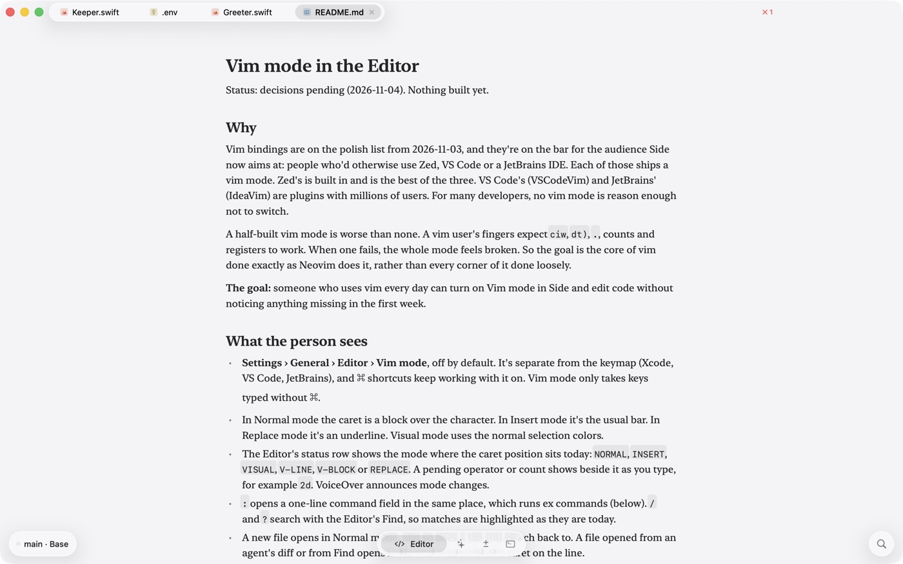

The bar floats over the content with no inset and no fade. Code, the Markdown preview and
terminal output run straight under the stage control, the track pill and search, and the glass
makes the text behind it look smeared. Rex, Arc and Safari all fade content out before it
reaches their floating chrome.

**Fix:** every scrolling surface gets a bottom content inset of the bar's height, and a short
gradient (about 40 pt, the window background going transparent) sits behind the bar. The last
line of a file then scrolls clear of the bar.

### 2. With one file open, its name is nowhere

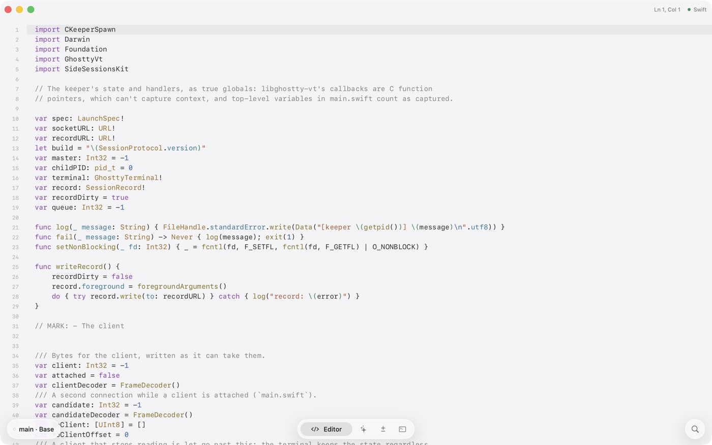

The tab strip only appears from two tabs on, so with one file open nothing says which file it
is. Every editor shows it. It's the most basic "where am I".

**Fix:** show the strip from one tab. A single tab is a chip like any other, with no close
button until hover. The open-out-of-the-first-tab motion still works from one to two.

### 3. Three accents and two selection styles

| | |
|---|---|
| 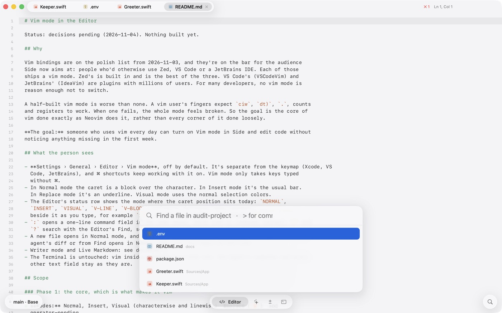 | 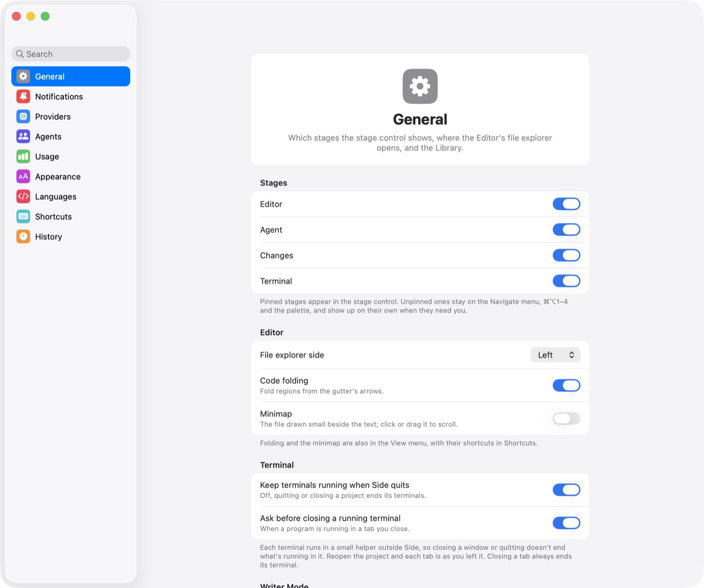 |
| 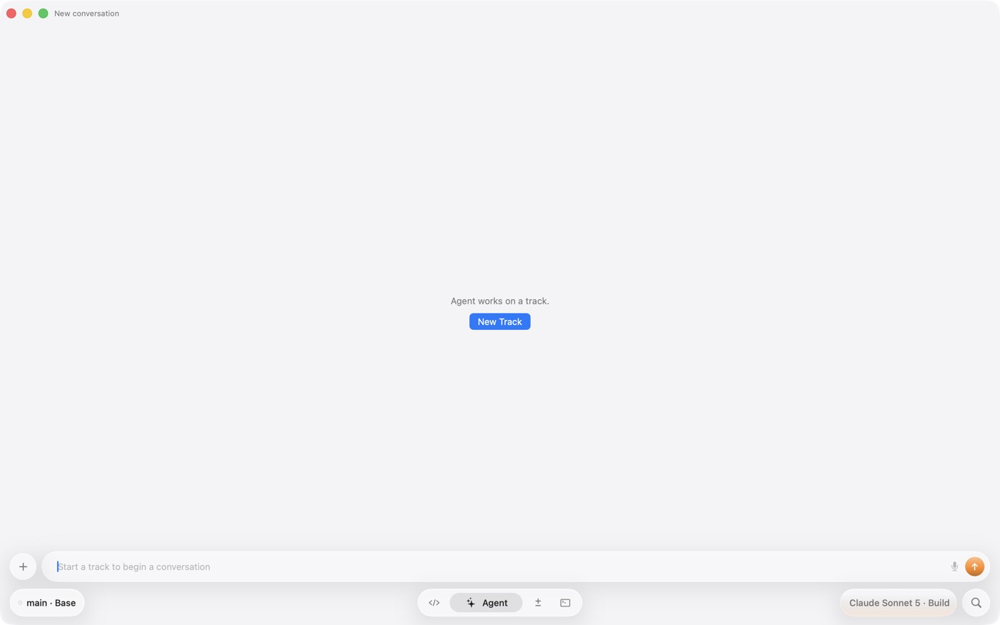 | 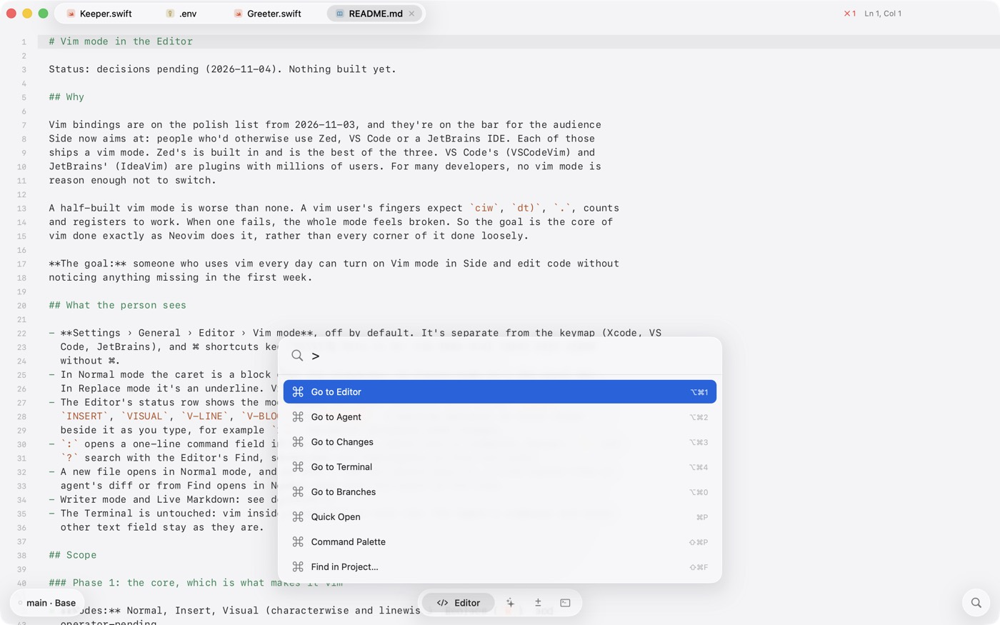 |

Side's own selection is a soft gray capsule (tabs, the stage control). Quick Open, the palette,
the Settings sidebar, the toggles and every "New Track" button use saturated system blue
instead. The Agent's send button is orange. Three colors claim to be "the" accent, and the
selected row in Quick Open is the loudest thing in the window.

**Fix:** one accent. Selection is the gray capsule everywhere, including list rows in Quick
Open, the palette and Settings. The accent, one color, is kept for the single primary action on
a screen (send, the empty state's action) and for focus. That's a `DS` rule first, then a sweep.

### 4. The palette's rows all look alike

Every command row starts with the same ⌘ glyph. Quick Open's placeholder is cut off ("Find a
file in audit-project · > for comr").

**Fix:** each command gets its own icon, with stage commands taking the stage's icon. The
placeholder gets shortened to fit ("Open a file, or > for commands").

### 5. Dark mode: the search button stays light

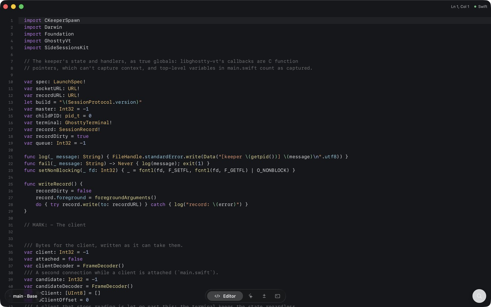

After switching to dark, the search circle at the bottom right stays a light gray disc while
everything else turns dark. It corrected itself only once the window was resized, so it looks
like a glass view not redrawing on an appearance change. People who follow the system's
light/dark switch at sunset will see it.

**Fix:** redraw that button's glass (and check the other glass buttons) when the appearance
changes.

### 6. Changes shows nothing on the base branch

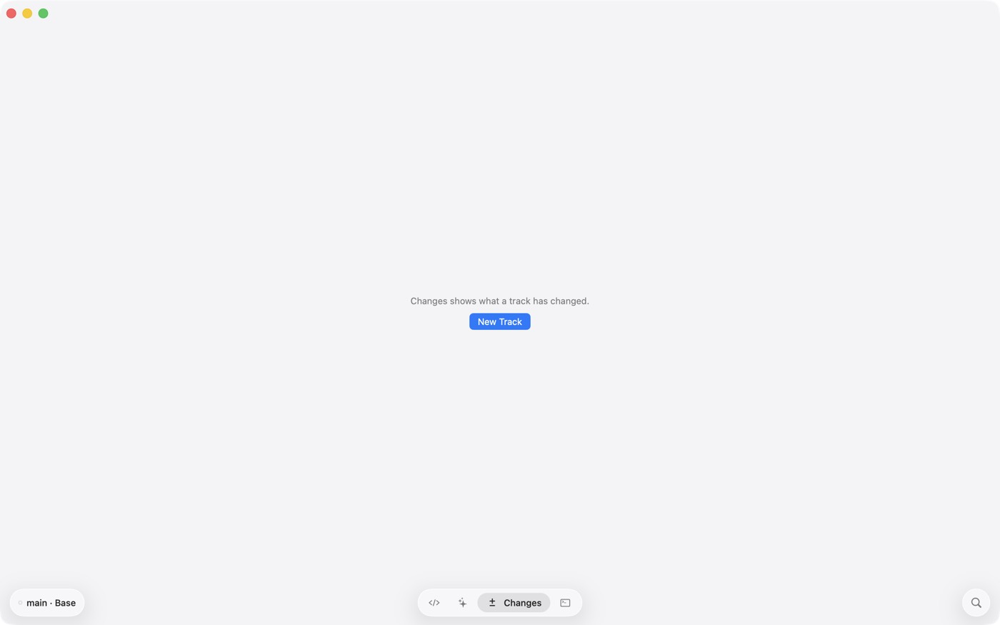

The fixture has two changed files on `main`. Changes says "Changes shows what a track has
changed" and offers New Track. The stage named for changes doesn't show them. That's the
git-derived tracks work (every branch is a track, so `main` has a diff too). Until then, it's
the most surprising screen in the app.

### 7. The terminal's status row is noisy, and tabs share a name

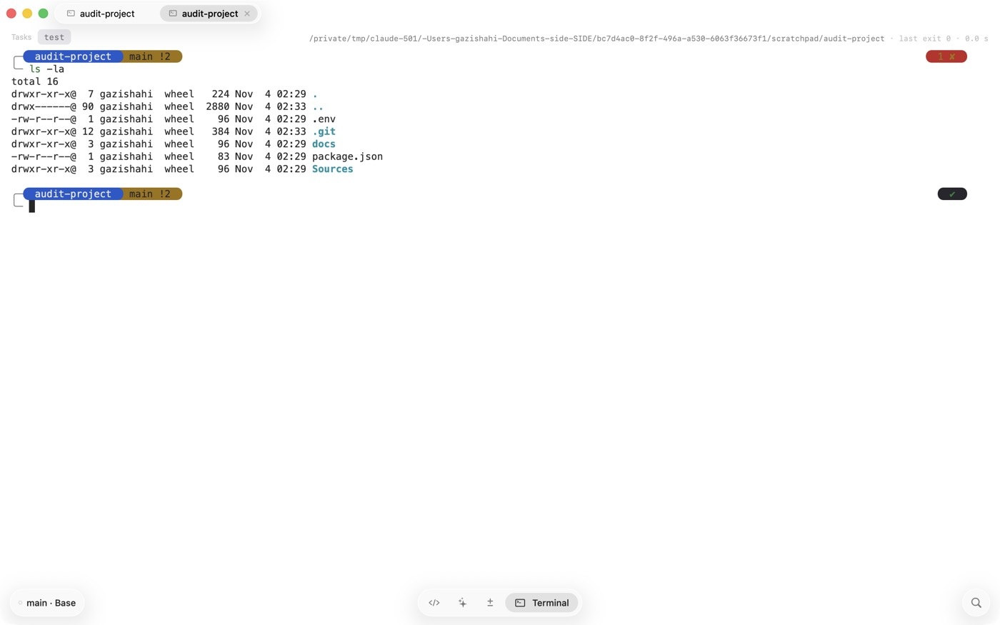

Above the terminal sits a row with "Tasks", a "test" chip, the full absolute path
(`/private/tmp/claude-501/-Users-…/audit-project`) and "last exit 0 · 0.0 s". It's a debug
readout, not a status. Both tabs are named "audit-project", so nothing tells them apart.

**Fix:**
- Show the path relative to the project, or `~/…`, and only when it differs from the
  project root.
- Show the exit status only when it failed.
- Move tasks into the palette and the tab's menu.
- Number same-named tabs ("audit-project 2"), as Terminal.app does.

### 8. Resizing a terminal duplicates the prompt

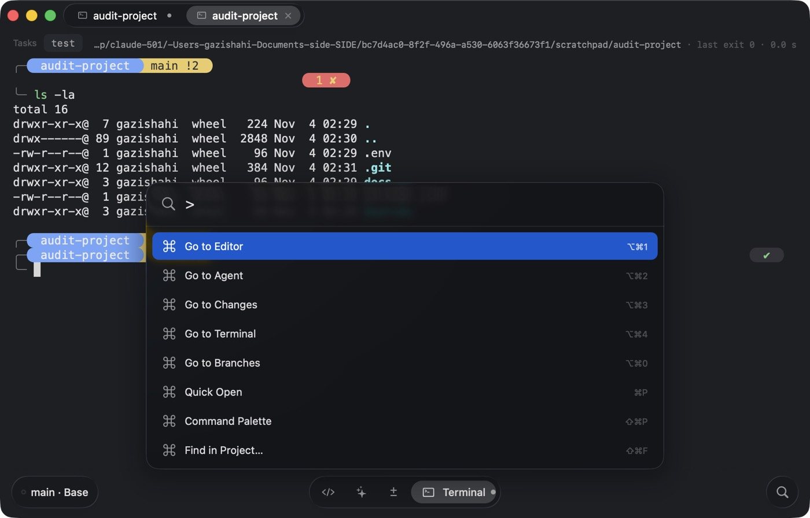

After a resize, a two-line prompt (Powerlevel10k here) is drawn twice and the right prompt
lands mid-line. This is SwiftTerm's reflow. The libghostty-vt move from the terminal benchmarks
fixes it, since Ghostty reflows prompts using shell integration. Worth knowing it's a reason to
do that move sooner.

## Tier 2: seen often, reads as unfinished

### 9. Empty states are a sentence and a blue button

The Agent, Changes and Branches stages, with nothing to show, each put one gray sentence and a
blue "New Track" button in the middle of an empty canvas. Branches shows two New Track buttons
at once.

**Fix:** design one empty-state component, used everywhere. It has the stage's icon at a
large size, a heading, a line of explanation and one action in the accent. Branches keeps its
toolbar button and drops the second one.

### 10. Branches looks like stock AppKit

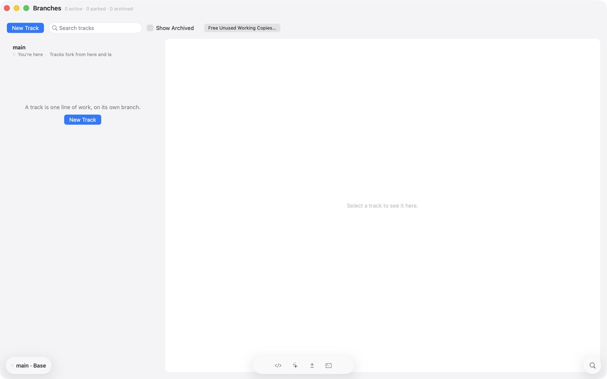

It has a stock checkbox ("Show Archived"), a gray bevel button ("Free Unused Working
Copies…"), a white detail panel with nothing in it, and a truncated subtitle ("Tracks fork from
here and la"). It's the one stage that doesn't use Side's components. The git-derived tracks
RFC rewrites this stage anyway, so the fix belongs there. Until then, at least the subtitle can
wrap.

### 11. The track switcher is a stock popover

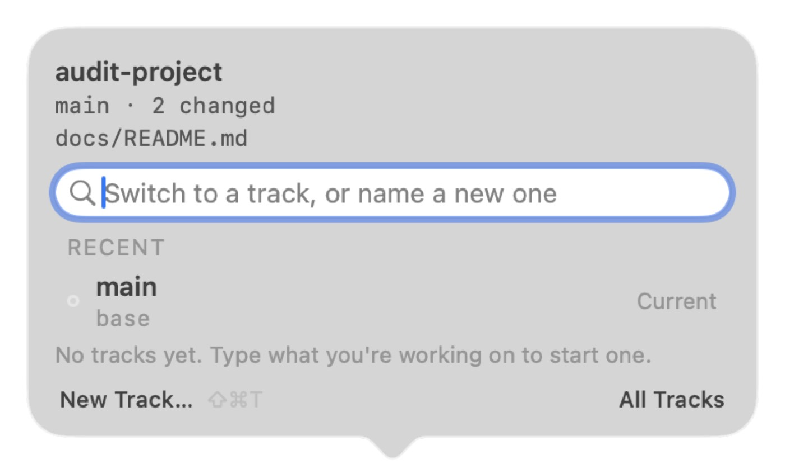

It's a gray NSPopover with an arrow, a system-blue focus ring around its field, and monospace
text mixed with the system font. Quick Open and the palette float as glass panels; this should
be one of those, opening up from the track pill.

### 12. The track pill's idle ring reads as a glitch

The faint empty circle before "main · Base" is the Idle status dot. At that size and contrast
it looks like a rendering artifact. With project switching (below), that slot becomes the
project's icon.

### 13. The top-right status is cryptic

The red "×1" is the problem count. It shows on every file, including README.md, because the
count is the whole project's, and it has no label. The green dot beside "Swift" (the language
server's state) has no tooltip. In the Markdown preview the "×1" floats alone.

**Fix:**
- Make the problem count the file's own, with the project's in its tooltip.
- Label both items.
- Hide the count in previews.

### 14. The Markdown preview's inline code and line heights

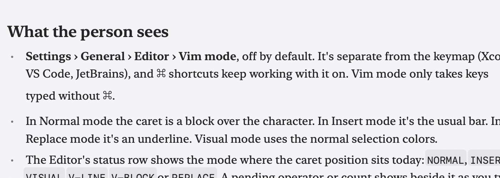

- Code chips are taller than the line, so the chips on neighboring lines touch.
- Chips side by side merge into one block. The ", " between `NORMAL` and `INSERT` almost
  disappears.
- A line with a ⌘ in it is taller than the others. The glyph falls back to a font with
  taller metrics.

**Fix:**
- Give chips a fixed inset inside the line height.
- Leave a gap between neighboring chips.
- Pin the line height so fallback glyphs can't change it.

### 15. Find's controls aren't Side's controls

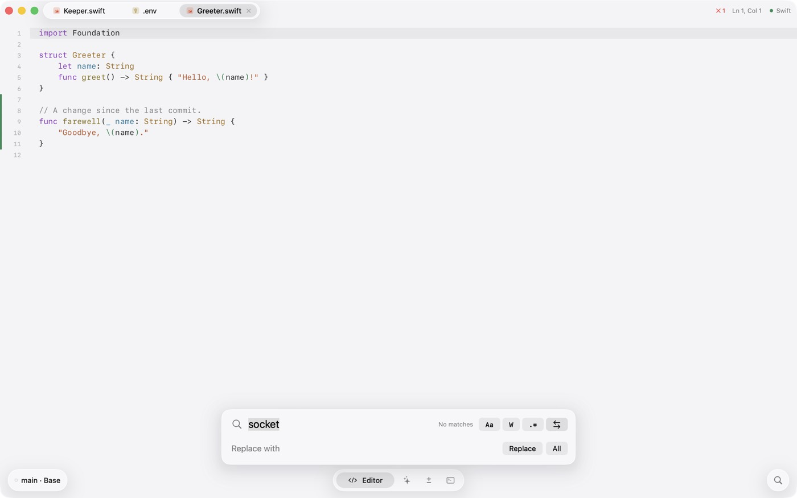

The case, word and regex toggles (Aa, W, .*) and Replace / All are square gray buttons. The
rest of the floating chrome uses capsules and the gray selected capsule for "on".

### 16. Ultrawide: the bar's ends drift apart, and the composer stretches

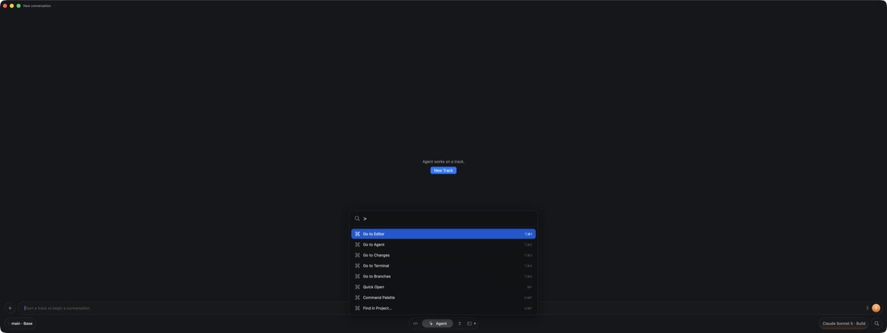

At 3000 pt the track pill and search sit about 2900 pt apart, and the Agent's composer spans
the whole width. The Markdown preview already holds a readable column, so do the same for the
composer and conversation (about 760 pt). The bar's side pieces can stay at the edges, but the
composer shouldn't be wider than the conversation above it. (The palette in this capture was
left open by the test run.)

### 17. Running Terminals is a stock table

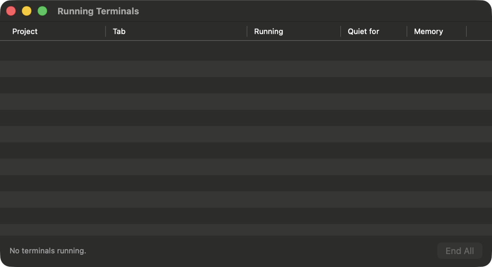

It's an empty striped table with no empty state, stock column headers and a stock End All. If
the activity pill (below) happens, this window becomes its "show all", and gets the same rows.

### 18. Smaller things

- The Agent's composer, while it can't send ("Start a track to begin a conversation"), still
  shows a caret and a bright orange send button that looks enabled.
- The gutter's change bar sits at the window's very edge, apart from the line numbers it
  belongs to. VS Code and Zed draw it beside the numbers.
- Settings' page header (a large icon in a card) takes a fifth of the page on every pane. The
  stage rows in General have no icons, although the stages now do.
- A Terminal tab's icon is the generic terminal glyph whatever runs in it. See "Program icons"
  below.

## The running indicator

The breathing ring is out (the owner: "lazy and ugly"). Options, from most to least
distinctive:

1. **The program's own mark, alive.** Claude Code's tab shows Claude's mark, turning slowly
   while it works and still while it waits, which is what Claude Code's own ✳ spinner does in
   its title. Other agents get their mark and the same motion. This is the strongest of the
   four, but it needs the program icons (below).
2. **A shimmer across the tab's title**, a highlight sweeping left to right every 1.5 s. Claude
   and Cursor use this for "thinking". It needs no icon and works for any program, but it's
   subtle in an inactive tab.
3. **Three dots after the title**, rising in turn. This is Rex's. It reads instantly, but it's
   Rex's signature.
4. **A hairline under the tab** sweeping like Safari's loading bar. It's very quiet.

Recommended: 1 where there's a mark, and 2 for everything else. Whichever it is becomes the
app's one "working" indicator, replacing the breathing ring everywhere it's used today (track
dots, the stage control's badge, Branches), so `DS.StatusDot.working` changes once and every
surface follows.

## Program icons for Terminal tabs

The tab's icon comes from what's running in it:
- **Agents:** Claude Code, Codex, OpenCode, Gemini and Aider each get their mark.
- **Editors and tools:** vim/nvim, lazygit/tig, node, python, ssh and docker each get an
  SF Symbol or a simple mark.
- **Anything else:** the terminal glyph.

The foreground program is already known (the keeper's record, the shell's marks and the
title).

One question is yours: the agents' marks are their companies' trademarks. Rex ships them, and
Anthropic and OpenAI publish brand guidelines for integrations. Using the marks to say
"Claude Code is running here" is the usual case those guidelines allow. I'd follow the
guidelines (official artwork, unaltered, no implied endorsement) and keep the marks out of
Side's own branding.

## The activity pill and project switching

### Activity pill

One pill on the right of the bar, there only while something is running out of sight. That
means an agent in a Terminal tab you're not looking at, an Agent turn while you're in the
Editor, a check in Changes, or an update downloading. It shows the working indicator and a
count ("2 running"). Clicking it lists each job with its project and stage, and clicking a job
goes there.

What makes it worth having: it absorbs other things instead of adding to them. The update
pill's download becomes one of its jobs (the green "Relaunch to Update" stays its own pill,
since that's an action, not activity). The stage control's attention dots stay, but only for
"needs you". Running Terminals becomes its "Show All". Without that merging, it's one pill too
many.

### Project switching in one window

It's a good fit, and Sill has already worked out the design. The bottom-left pill becomes
Sill's context chip, with two axes:

- **The project:** its icon (Sill's per-space glyph and color, so projects differ by shape,
  not color alone) and, briefly after switching or on hover, its name. Swiping on the chip
  goes to the previous or next project, and ⌃1–9 jumps to one. Each switch shows Sill's
  indicator above the bar: a dot per project, the current one expanded with its name.
- **The track:** clicking the chip still opens the track switcher, now one level under the
  project.
- **Attention:** a project that needs you (an agent finished, a terminal rang) gets a dot on
  its icon in the indicator and a small mark on the chip, so you can see that something
  elsewhere wants you before you switch.

What makes it cheap: projects already outlive their windows. `ProjectContextRegistry` keeps
each project's tabs, and the keepers keep its terminals running. Switching in place means the
window swaps which project context it shows, which `openProject(at:)` mostly does already. Each
project remembers its stage, tab and scroll. Windows stay for side-by-side work (Open in New
Window).

The risk is that the left chip carries three things (project, track, attention). Sill's
"name only when useful" rule is what keeps it calm.

## Built during the audit: the stage bar

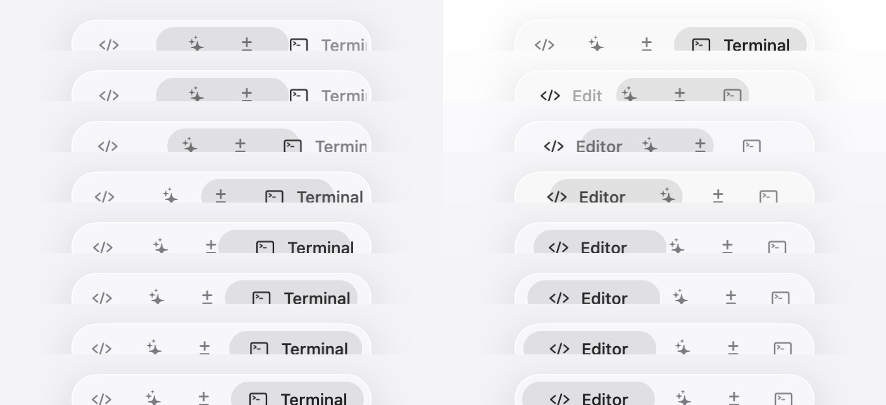

The selected stage shows its icon and name, and the others only their icon (the owner's
idea). Switching widens the new segment as the old one narrows. The old name fades before its
segment closes over it, and the new one fades in as it opens. The bar keeps one width whatever
is selected, so nothing else in the bar moves. The animation is committed before the stage
loads, so switching to Terminal for the first time still slides instead of jumping.
