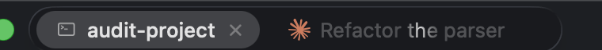
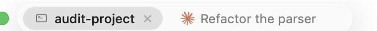
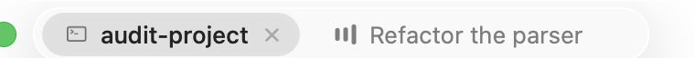
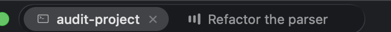

# Work log, night of 2026-11-04

Status: reference. Done on my own between 03:09 and 06:09, while the owner was away. The rules
were: commit as I go, track progress here, and make no releases of Side or Alloy. Every visual
change was checked on a built app through the UI-testing channel before it was committed.

## Asked for (from the owner's notes on the visual audit)

1. The stage bar's status dots were cut off on stages showing only an icon.
2. Running indicator: no spinning logo and no three dots. Try options that look good, read
   clearly and aren't generic. The shimmer was of interest.
3. Program icons on Terminal tabs: Claude's mark while Claude Code runs.
4. A design-system pass, then a sweep of audit items 3–7 (one accent and one selection style,
   palette icons, the dark-mode search button, Changes on the base branch, the Terminal status
   row). Item 2 is wanted, but without showing a tab for a single item.
5. Prototype the activity pill (a "glorified notification center") and project switching in
   one window. The switcher should be beautiful and efficient, not an Overview.

Not to change: content running under the bottom bar. It's intentional, so the Liquid Glass shows
in full.

## Progress

### 03:10 — stage bar dots

Done. A segment showing only its icon keeps the icon centered and the dot just after it, inside
the segment. Checked with dots on three stages at once (`stage-badge` test command).

### 03:15 — running indicator prototypes and program icons

The breathing ring is gone from tabs. Four styles are built and switchable, so they can be
judged in the app instead of from a description. Switch with
`defaults write com.shahi.side tabs.workingStyle <style>`, or the `working-style` test command:

| Style | What it does | Light | Dark |
|---|---|---|---|
| `shimmer` (default for now) | A band of light sweeps across the title, which sits a step quieter while it works |  |  |
| `edge` | A short light runs around the tab's outline |  |  |
| `caret` | A terminal's block caret blinks after the title |  |  |
| `meter` | Three bars in the icon's place, moving like a level meter |  |  |

My read:
- **Shimmer** is the calmest and works on any program.
- **Edge** is the most "Liquid Glass", but on an inactive tab it outlines a capsule you can't
  see, so it floats.
- **Caret** is the most Terminal-specific and the easiest to read: it says "typing".
- **Meter** would be the most honest if it were driven by real output (it's a loop for now).

Each GIF is a fake `claude` script setting Claude Code's working title.

Program icons: a Terminal tab's icon is now what runs in it.
- **Claude Code:** Claude's mark, in its own color. The artwork is the single path from
  Wikimedia Commons' "Claude AI symbol.svg", sourced to anthropic.com.
- **Codex:** OpenAI's blossom, drawn in the tab's text color.
- **Editors, git tools, package managers, containers, ssh, monitors and build tools:**
  SF Symbols.
- **Anything else:** the terminal glyph.

Found on the way: inactive tab titles were drawn as dark as the active one, because
`withAlphaComponent(1)` replaced the system's secondary color's transparency. They're quieter
now, as designed.
