# Work log, night of 2026-11-04

Status: reference. Done on my own between 03:09 and 06:09, while the owner was away. The rules
were: commit as I go, track progress here, and make no releases of Side or Alloy. Every visual
change was checked on a built app through the UI-testing channel before it was committed.

## Morning, after the owner's testing (07:00–10:00)

The owner tested the night's work and found real regressions. The night's "checked on screen"
had a hole: the UI-testing setup couldn't start keepers (socket path too long) and had no Claude
Code, so the paths that broke were never run. Fixed first:

- **Test setup** (`scripts/uitest/`): builds a copy in `/tmp/side-uit`, short enough for keeper
  sockets; a stand-in `claude` (`fake-claude.c`) that does at the terminal what Claude Code does
  (startup queries, spinner titles, the bell); and repeatable checks: `check-terminal-agent.sh`,
  `check-activity.sh`, `check-tab-close.sh`. Each reproduced its bug before the fix.
- **Window stretched past the screen:** the activity pill appeared with a long title, and the
  bar's required constraints outranked the window's size. Its title now truncates, the bar can't
  widen the window, and the bar's docking is re-checked as the pill changes.
- **No Claude mark / garbled pill:** the program was named from keystrokes. An accepted
  autosuggestion read "claOC", a message to Claude became the "command", and the terminal's
  replies to Claude's queries became the pill's title. Now it comes from the foreground process
  (`ForegroundProgram`, shared with the keeper).
- **The X sometimes did nothing:** a second close during the first's animation removed the wrong
  tab, after which the strip and the tabs disagreed. Rapid closes also clipped and jumped. The
  strip and the tabs now change together; the glass narrows frame by frame with the tabs.
- **⌘1–9 in Terminal**, the **stage bar jumping** when leaving Branches, a **completion dot**
  (green finished, amber wants you), **"+N"** on the pill, one item **goes straight there**.
- **Documents prompts:** dev and test builds shared `com.shahi.side` with another signature, so
  macOS's grant flipped between identities. Debug is now `com.shahi.side.dev`, UI tests
  `com.shahi.side.uitest`, and the keeper is signed as `<app>.SessionKeeper` (it was
  `.SideSessionKeeper`). **Terminals started by a dev build keep that identity until they end:
  close those tabs once.**
- **Project chip** at the bar's leading edge, with the repository's logo (logo/favicon files, an
  Icon Composer bundle as Side's own, an AppIcon set), and its own switcher. The track pill is
  about tracks again.
- **Reattaching after a relaunch** happened at SwiftTerm's 80×25 placeholder before layout: the
  screen came back resized twice (cursor row off). Terminals now start and rejoin at their real
  size. (A prompt segment that seemed to come back on its own row was my test's doing: the
  relaunched window had a saved, narrower size. At the same width the screen comes back exactly;
  a width change makes zsh's prompt redraw messily, as in any terminal, and SwiftTerm doesn't
  re-join lines it wrapped, which a ghostty-based Run would.)

- **Running Terminals**, seen populated for the first time: the End buttons were cut off and
  stretched, and labels sat at the rows' tops. Agents show by name ("Claude Code").
- **Working tabs move in step:** every tab's shimmer, edge light or glint runs on one clock, so
  several working tabs move as one (the owner's worry about the edge light on many tabs).
- **Activity pill keeps its size:** as wide as its longest state, the ring and the dot in one
  slot, so "working" turning "finished" doesn't move it. Crowded (with the update pill, in a
  narrow window) its title truncates instead of being cut off under its neighbour. The update
  is no longer listed in it, since its own pill says so.
- **A slip, caught:** I committed one batch while its test run had failed (a new doc's status
  word wasn't an allowed one); the commit was undone at once, never pushed, and redone after a
  passing run.

New RFC: `docs/SIDE_RFC_SHARED_CLAUDE_SESSIONS.md`. Terminal and Agent can share Claude Code chats;
verified in the adapter (it lists and reopens the CLI's own sessions).

Not done, on purpose: removing Agent's modes (they're Heron's Ask/Plan/Build scopes and approval
levels, tied to the Heron-retirement decision); Agent's wide-screen layout (a design to agree).

## Start here (night)

**Your decisions:**
1. **The running indicator.** Try the five styles in the app with
   `defaults write com.shahi.side tabs.workingStyle shimmer|edge|caret|meter|glint`, or watch
   the GIFs below. Shimmer is the default for now. Status dots elsewhere (tracks, the stage
   bar's badges) still breathe until this is decided.
2. **The activity pill:** keep "· 1 more", or only the list? And should a finished turn read
   "Finished" or "Your turn"?
3. **Project switching:** the symbols and colors are picked automatically, and the pill's
   right-click menu changes them. Should ⌃1–9 stay (Mission Control uses ⌃1–9 for desktops when
   that's turned on)?
4. **Agent mode colors:** the Build mode's orange send button is the last non-accent color in
   the chrome. Keep the mode tints?
5. **`docs/SIDE_RFC_GIT_TRACKS.md`:** four decisions at its end.

**What to look at first:**
1. Build and open two projects.
2. Switch between them: swipe on the bottom-left pill, use ⌃1/⌃2, or the pill's popover.
3. Start Claude Code in a Terminal tab of one, then go to the Editor or the other project: the
   activity pill says what it's doing, and its list takes you back.

**Not touched:** releases (none made), Alloy (only last night's unreleased `.env` mapping is in
it), vim (the RFC's decisions are still yours).

## Asked for (from the owner's notes on the visual audit)

1. The stage bar's status dots were cut off on stages showing only an icon.
2. Running indicator: no spinning logo and no three dots. Try options that look good, read
   clearly and aren't generic. The shimmer was of interest.
3. Program icons on Terminal tabs: Claude's mark while Claude Code runs.
4. A design-system pass, then a sweep of audit items 3–7 (one accent and one selection style,
   palette icons, the dark-mode search button, Changes on the base branch, the Terminal status
   row). Item 2 is wanted, but without showing a tab for a single item.
5. Prototype the activity pill (a "glorified notification center") and project switching in
   one window. The switcher should be beautiful and efficient, not an Overview.

Not to change: content running under the bottom bar. It's intentional, so the Liquid Glass shows
in full.

## Progress

### 03:10 — stage bar dots

Done. A segment showing only its icon keeps the icon centered and the dot just after it, inside
the segment. Checked with dots on three stages at once (`stage-badge` test command).

### 03:15 — running indicator prototypes and program icons

The breathing ring is gone from tabs. Four styles are built and switchable, so they can be
judged in the app instead of from a description. Switch with
`defaults write com.shahi.side tabs.workingStyle <style>`, or the `working-style` test command:

| Style | What it does | Light | Dark |
|---|---|---|---|
| `shimmer` (default for now) | A band of light sweeps across the title, which sits a step quieter while it works |  |  |
| `edge` | A short light runs around the tab's outline |  | 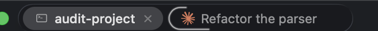 |
| `caret` | A terminal's block caret blinks after the title |  | 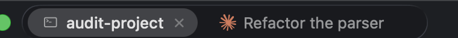 |
| `meter` | Three bars in the icon's place, moving like a level meter |  |  |
| `glint` (added 04:35) | A soft band of light drifts across the whole tab, as light moves through glass; quiet, very faint in dark |  | 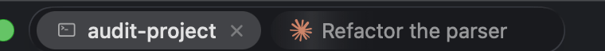 |

My read:
- **Shimmer** is the calmest and works on any program.
- **Edge** is the most "Liquid Glass", but on an inactive tab it outlines a capsule you can't
  see, so it floats.
- **Caret** is the most Terminal-specific and the easiest to read: it says "typing".
- **Meter** would be the most honest if it were driven by real output (it's a loop for now).

Each GIF is a fake `claude` script setting Claude Code's working title.

Program icons: a Terminal tab's icon is now what runs in it.
- **Claude Code:** Claude's mark, in its own color. The artwork is the single path from
  Wikimedia Commons' "Claude AI symbol.svg", sourced to anthropic.com.
- **Codex:** OpenAI's blossom, drawn in the tab's text color.
- **Editors, git tools, package managers, containers, ssh, monitors and build tools:**
  SF Symbols.
- **Anything else:** the terminal glyph.

Found on the way: inactive tab titles were drawn as dark as the active one, because
`withAlphaComponent(1)` replaced the system's secondary color's transparency. They're quieter
now, as designed.

### 03:45 — design-system pass and sweep (audit items 2–7)

- **One selection style** (item 3): `DS.SelectionRowView` is the soft selected capsule tabs and
  the stage control use. Quick Open, the palette, mention lists and Settings' sidebar use it in
  place of system blue. In Settings, the selected name no longer turns blue (the cell recolored
  it for the selection). Toggles and focus rings stay the system's.
- **The Agent's orange send button is not a stray accent.** It's the Build mode's color (Plan
  and Build tint the composer). I left it alone. Decide whether modes keep their colors.
- **Palette icons** (item 4): each command has its own symbol, and stage commands use the
  stage's.
- **Dark-mode search button** (item 5): its glass is rebuilt when the appearance changes.
- **Terminal status row** (item 7):
  - The folder shows only once the shell leaves the project's root, relative to it while inside.
  - The last command shows only when it failed or took 10 s or more.
  - Same-named tabs are numbered ("audit-project 2").
- **One file open** (item 2, no tab for a single item): the top row shows the file's icon and
  name, plain, where the tab would start. It fades in as a closing strip fades out.
- **Changes on the base branch** (item 6) is left for the git-derived tracks work. Showing
  `main`'s working changes needs the base to be a track.
- **Terminal reflow** (item 8) is left for the libghostty-vt move.

### 03:50 — activity pill (prototype)

`ActivityCenter` gathers, across every open project:
- an agent working in a Terminal tab you aren't looking at, or one that finished there;
- an Agent turn on any track that's working, needs you, failed or finished;
- an update downloading.

"Out of sight" means not on screen in Side's front window. A tab shown in the Terminal stage
while the window is on the Editor counts as out of sight.

The pill sits beside search, only while there's something. It names the most pressing item
("Claude Code working", "Codex finished · 1 more"): needs-you first, then failures, then
finished, then working. Clicking it lists every item with its program's mark, its project and
tab, and its state. A row goes there, switching project, track and stage as needed.

Open questions:
- The count ("· 1 more"): keep, or only the list?
- The working mark is the update pill's spinning ring for now. It'll take whatever the running
  indicator becomes.
- The list is a stock popover, like the track switcher.

### 04:00 — project switching in one window (prototype)

- **`ProjectSpaces`:** the projects you move between, in a fixed order, each with an SF Symbol
  no other project has and a color from Sill's palette.
- **Switching** moves the window to the other project in place. The project left is held open
  in the background, so its terminals and agents keep going. The activity pill reported a fake
  Claude still running in the first project while the window was on the second.
- **The pill:** the project's mark leads it, where the idle ring was. The track's status dot now
  rides on the mark, and only when there's something to say.
- **Ways to switch:**
  - a two-finger swipe across the pill (previous or next);
  - ⌃1–9, and ⌃⌘[ ⌃⌘] for previous and next (Window › Projects; ⌃[ would have stolen Escape
    from the Terminal);
  - the track popover's new project row, laid out like the stage bar: every project's mark,
    with the current one also named.
- **The indicator:** after each switch, a glass capsule above the pill shows every project's
  mark with the current one named, for 1.4 s.

Not done yet:
- Closing a project from the switcher.
- Choosing a project's symbol and color.
- A dot on a project that needs you.
- Moving a held project's terminals when its window closes.

### 04:10 — more of the audit's second tier

- **Empty states (9):** each carries its stage's symbol, large and quiet, above the sentence.
  Branches no longer shows a second New Track button under the one in its header. Its base
  row's subtitle fits now ("Tracks start and land here").
- **Problem count (13):** kept project-wide, as VS Code counts. Its tooltip and spoken label
  now say "in this project".
- **Markdown preview (14):**
  - Inline code chips are the code's own height around its baseline, and a little narrower, so
    chips on neighboring lines no longer touch and two chips a comma apart stay two.
  - Body line heights are pinned. One list line still sits a few points lower than the rest;
    I haven't found why, so it's left open.
- **Find (15):** Aa, W, .* and the Replace toggle are `DS.CapsuleToggle`s: plain until on, then
  the selected capsule. Replace and All are quiet capsules instead of the stock square bezel.
- **Ultrawide (16):** the Agent's conversation and composer sit in a centered column of at
  most 860 pt. On the first try that column's "fill the width" constraint was stronger than
  the window's own size, and it shrank the window to 860 pt. Its priority is under the window's
  now (490).

Found on the way: an Editor test pressed the top row at a fixed point, x = 300, to drag the
window. The new stage bar puts a button there, and a simulated press on a button waits forever
for a real mouse-up. The test now looks for a bare stretch of the top row. Separately, running
the suite from `~/Documents` waits on macOS's Documents-folder prompt for each rebuilt test
app, so tonight's runs use a copy of the repo outside Documents.

### 04:40 — after

The same captures as the audit, on tonight's build:

| | |
|---|---|
| One file open, its name in the top row 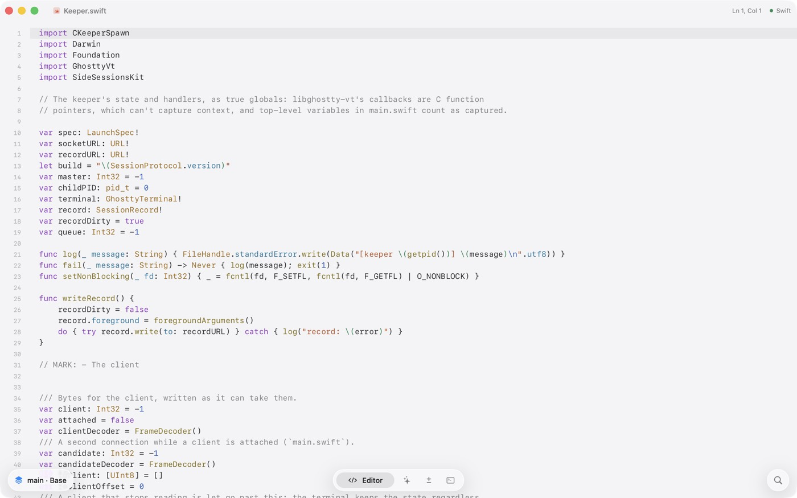 | Dark mode, the search button dark 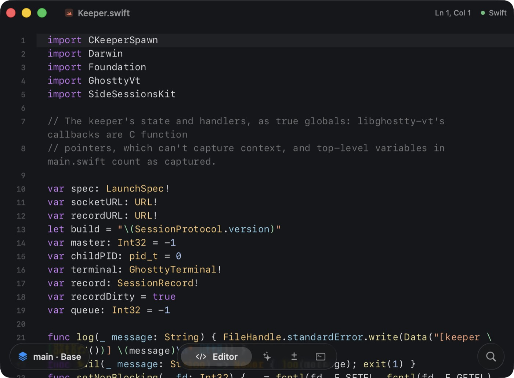 |
| Terminal: numbered tabs, a quiet status row 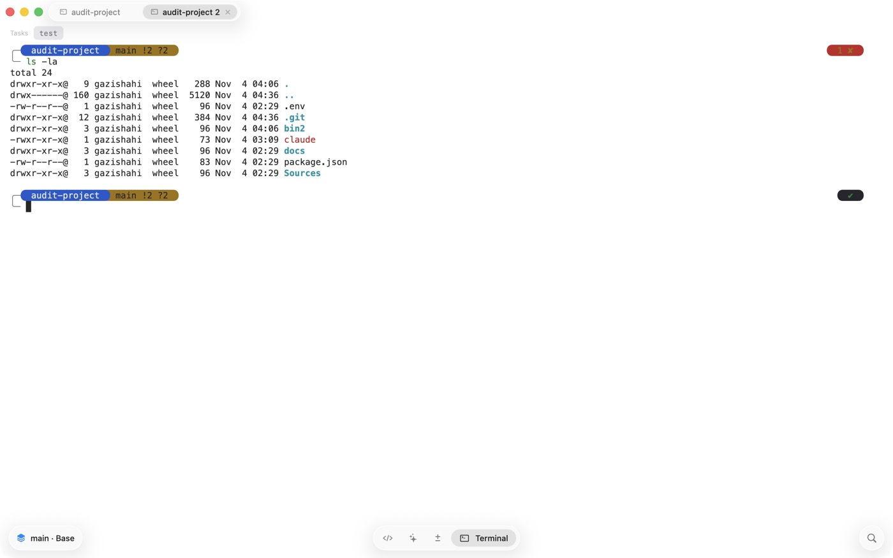 | Palette: the capsule selection and its own symbols 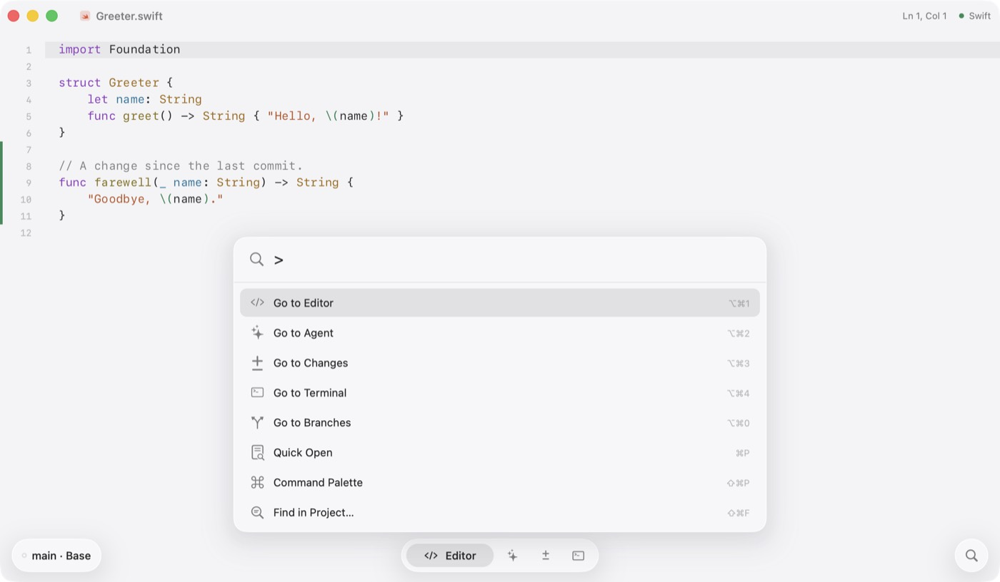 |
| Agent's empty state 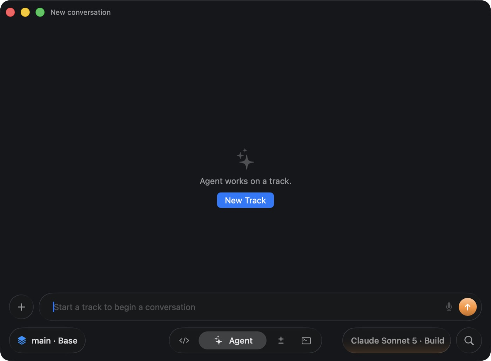 | Branches: one New Track button 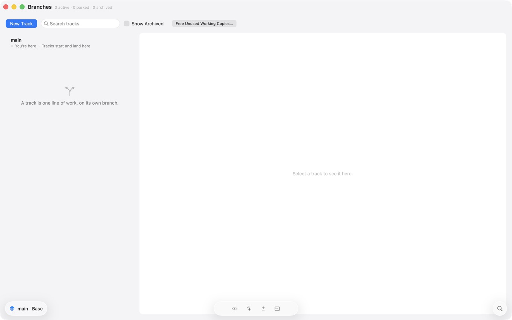 |
| Activity pill, on Terminal (none), on the Editor, in dark 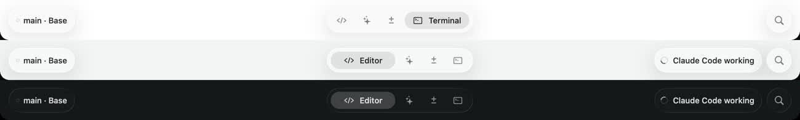 | Its list 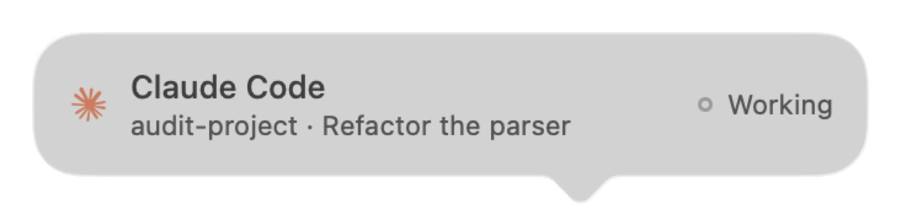 |
| Switching projects: before, the indicator, after, back 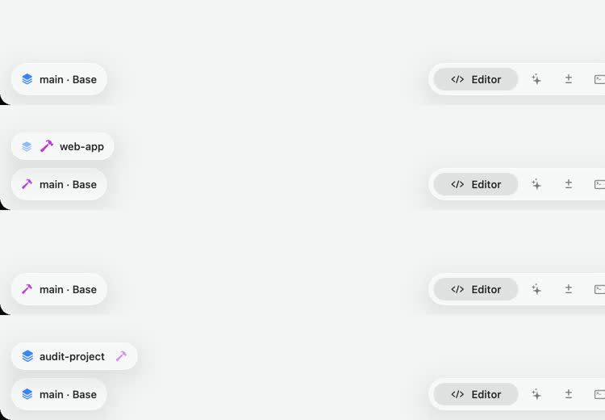 | The switcher's project row 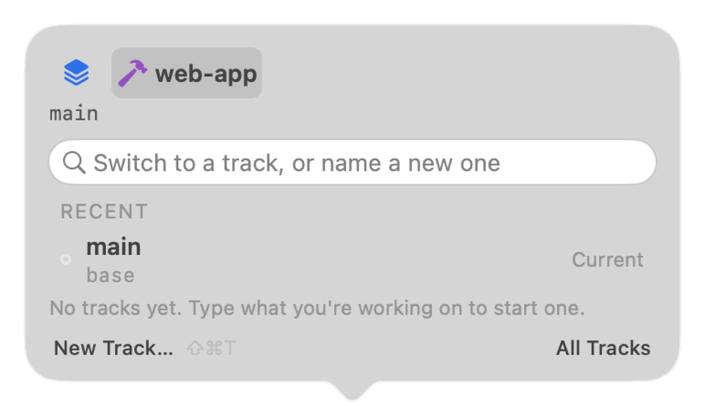 |

Also since the last commit:
- Running Terminals has an inset list and an empty state. In my test setup the keepers can't
  start, because the scratch folder's socket path is over the 104-character limit, so the
  window with rows in it is unverified.
- The track switcher's field has no system focus ring.
- The activity pill asks only working terminals, or ones with unseen output, what's running.

### 04:50 — project switching, fixed and finished

- **Bug: the Editor's tabs followed the window across projects.** Switching from audit-project
  to web-app left Greeter.swift and .env open in web-app. The window now puts the old project's
  tabs away and the new project's remembered tabs come back. Getting that right took three
  fixes:
  - Closing the old tabs wrote an empty list over that project's memory. Tab memory is now held
    off until the new project's tabs are back.
  - The restore checked remembered files against the project's index by exact path. The index
    can spell the same path another way (`/tmp` and `/private/tmp`), and those tabs were dropped
    as missing. It compares resolved paths now.
  - Checked on screen: audit-project → web-app → back gave Greeter.swift and .env; forward
    again gave index.ts.
- **The pill names the project only when it's useful** (Sill's rule): "web-app › main · Base"
  for 1.6 s after a switch and while the pointer is on the pill. Otherwise the mark says which
  project you're in.

### 04:55 — adding projects; a tracks RFC

- **The project row has a + to open another project.** Open Project in a window that already
  has one is now a switch: the project left stays open in the background, where before it was
  closed.
- **`docs/SIDE_RFC_GIT_TRACKS.md`** (decisions pending), item 3 of the direction list:
  - every local branch and worktree is a track, with no adopting;
  - Side's records become an overlay keyed by branch name;
  - a track's base is its PR's, the one chosen for it (git config), the one it was made from,
    or the default branch;
  - Changes shows something on any branch, the base included;
  - Branches is rebuilt as the board;
  - constitution articles 6 and 7 are rewritten.

  It also covers audit items 6 and 10.

### 05:00 — bells, and a cap on the switcher

- **A bell (BEL) from a terminal you can't see is "needs you"** in the activity pill: "bell.sh
  needs you" in amber. It clears once you go to the tab. A bell that rings while the tab is on
  screen in the front window isn't kept. Checked on screen: rung on the Editor stage, the pill
  said so, the row went there, and back on the Editor the pill was gone.
- **The switcher shows at most nine projects**, the ones ⌃1–9 reach, plus the current one if
  it's past them. Every project opened becomes a space, so the full list can run long.

A gap, found and closed: an agent that finished in the Terminal tab that was selected while
the window was on another stage wasn't caught as "finished", because Side only marks output
unseen when no view has the tab selected. A turn that ends out of sight is now remembered
(`turnFinishedAt`) until the tab is shown. Checked on screen: "Claude Code working", then
"Claude Code finished", then nothing once the tab had been visited.

A flake, noted: one full run crashed in `DebugServerSessionTests.testALauncherSessionItsTerminalAndItsChild`
(`-[NSFileHandle availableData]: unknown error` in `DAPSocketTransport.attach`, debugger code
not touched tonight). It passed three runs in a row on its own, and I committed only after a
clean full run. Cause: the socket's read handler called `availableData`, which raises an
Objective-C exception (an abort) on a handle closed under it. It now uses `read(2)`, which
returns an error, and the stream just ends. Other `availableData` readers read pipes, which a
process closes by exiting (EOF, not an exception), so I left them: the language-server
transport, ACP, the LSP installer, and the DAP transport's stdio path.

### 05:10 — cleaning up after my own tests

- **The unit tests had filled your real project switcher.** The test host opens dozens of
  throwaway projects (`…/T/parity-…`), and each became a space in `com.shahi.side`'s
  `side.projectSpaces`: 39 of them, none yours, since the feature is new tonight. I deleted the
  key. Under XCTest the switcher now keeps its own store (`side.tests.projectSpaces`).
- My style switching had written `tabs.workingStyle` to your preferences early in the night. It's
  deleted, and the test channel writes to its throwaway store now.
- The six keepers running in your sessions folder are yours (sill, side-demo-repo, side,
  started before you left). I didn't touch them.
